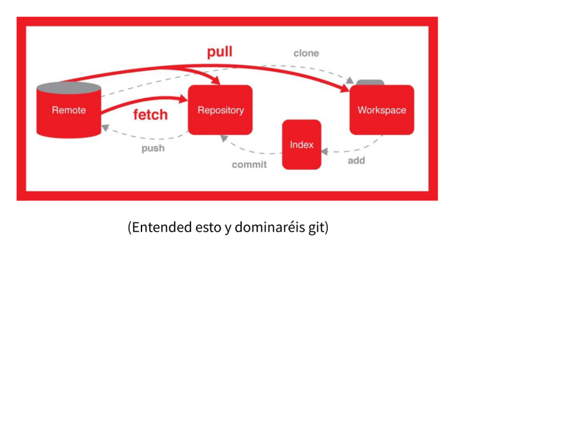
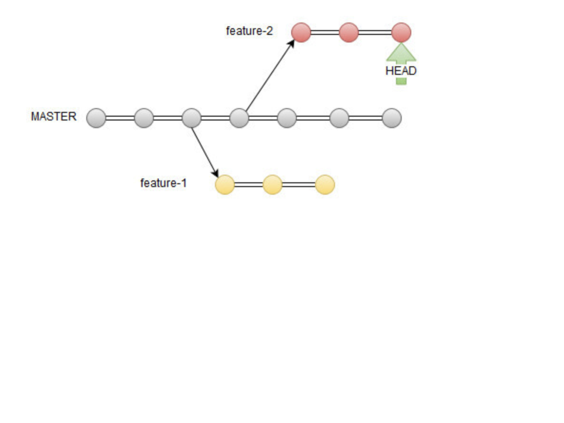

# GIT / GitHub. Resumen de comandos de interés (CLI)


**curso 2026-27 · Juan Carlos San Román**

> 
> **Declaración de uso de IA** · Guía de uso de la IA en el aula, Centro San Luis (nivel verde). Este material parte de los apuntes propios del profesorado (resúmenes de comandos Git y taller Git/GitHub); se ha utilizado IA para la redacción de los ejercicios, el formateo, el simulador y la comprobación de los comandos en una terminal real, con revisión y validación del profesorado.

Chuleta de comandos Git ordenados por funcionalidad. Cada bloque tiene una tabla `comando → comentario breve` y, cuando procede, una receta paso a paso lista para copiar. Al final de cada sección, **▶ Practica** enlaza con el ejercicio guiado correspondiente. El orden recomendado de estudio está en el [itinerario de los apuntes](README.md), y hay una versión de bolsillo con lo imprescindible en [Acciones habituales](GIT_acciones_habituales.md). Para practicar sin riesgo, el [🧪 laboratorio](https://jc-csl.github.io/git-github-practico/laboratorio/) tiene 50 ejercicios con terminal simulada en el navegador.

**Convenciones:** `<hash>` = identificador de commit (se ve con `git log --oneline`) · `origin` = nombre habitual del remoto · `main` = rama principal · ⚠️ = comando destructivo o que reescribe historial.

## Índice

**Bloque I. Primeros pasos**

1. [Conceptos mínimos](#1-conceptos-mínimos)
2. [Instalación y configuración inicial](#2-instalación-y-configuración-inicial)
3. [Autenticación SSH con GitHub](#3-autenticación-ssh-con-github)
4. [GitHub CLI (gh)](#4-github-cli-gh)
5. [Crear o clonar un repositorio](#5-crear-o-clonar-un-repositorio)
6. [Gestión de remotos](#6-gestión-de-remotos)

**Bloque II. Trabajo diario**

7. [Ciclo diario: add, commit, push, pull](#7-ciclo-diario-add-commit-push-pull)
8. [Inspeccionar: status, log, diff](#8-inspeccionar-status-log-diff)
9. [Deshacer cambios: restore, reset, revert, amend](#9-deshacer-cambios-restore-reset-revert-amend)
10. [Ramas y merge](#10-ramas-y-merge)
11. [Sincronizar con el remoto y resolver divergencias](#11-sincronizar-con-el-remoto-y-resolver-divergencias)
12. [Stash: guardar trabajo a medias](#12-stash-guardar-trabajo-a-medias)
13. [.gitignore y dejar de rastrear archivos](#13-gitignore-y-dejar-de-rastrear-archivos)
14. [Etiquetas (tags) y versiones](#14-etiquetas-tags-y-versiones)

**Bloque III. Avanzado, colaboración y copias de seguridad**

15. [Avanzado: rebase, rebase interactivo, cherry-pick, reflog](#15-avanzado-rebase-rebase-interactivo-cherry-pick-reflog)
16. [Colaborar en GitHub: fork, Pull Request y trabajo en equipo](#16-colaborar-en-github-fork-pull-request-y-trabajo-en-equipo)
17. [Servidor propio de copias de seguridad (repositorio bare)](#17-servidor-propio-de-copias-de-seguridad-repositorio-bare)
18. [Archivos grandes y Git LFS](#18-archivos-grandes-y-git-lfs)
19. [Finales de línea en Windows y Linux (CRLF y LF)](#19-finales-de-línea-en-windows-y-linux-crlf-y-lf)
20. [Alias](#20-alias)
21. [Problemas frecuentes: qué comando uso](#21-problemas-frecuentes-qué-comando-uso)

---

## 1. Conceptos mínimos



| Zona | Qué es | Cómo se llega |
|---|---|---|
| **Working directory** (*workspace*) | Carpeta de trabajo, archivos tal como los editas | Editando |
| **Staging** (*index*) | Cambios preparados para el próximo commit | `git add` |
| **Repositorio local** | Historial de commits, en la subcarpeta `.git` | `git commit` |
| **Repositorio remoto** | Copia en otro sitio: GitHub o tu propio servidor (`origin`) | `git push` / `git pull` |

| Término | Significado |
|---|---|
| `HEAD` | Puntero al commit actual (normalmente el último de la rama en la que estás) |
| `HEAD~1`, `HEAD~2` | El commit anterior, el de dos atrás… |
| `origin/main` | Copia local de cómo estaba la rama `main` del remoto en el último `fetch` |
| *upstream* | Rama remota vinculada a tu rama local; permite usar `git push` / `git pull` sin argumentos |
| Repositorio *bare* | Repositorio sin carpeta de trabajo, solo historial; es lo que hay "dentro" de GitHub o de un servidor de copias (ver [17](#17-servidor-propio-de-copias-de-seguridad-repositorio-bare)) |

**Ventajas de la CLI:** acceso a todos los comandos, se puede usar en scripts para automatizar, y es igual en Windows, Linux y Mac.

---

## 2. Instalación y configuración inicial

- **Windows:** instalar desde <https://git-scm.com/downloads/win> (o `winget install --id Git.Git`). Se trabaja con **Git Bash** (terminal tipo Linux).
- **Linux:** `sudo apt install git` y se usa desde la terminal bash de forma nativa.

| Comando | Comentario |
|---|---|
| `git --version` | Comprueba la instalación |
| `git config --list` | Revisa la configuración actual |
| `git config --list --show-origin` | Igual, indicando en qué archivo está cada valor |
| `git config --global user.name "Tu Nombre"` | Nombre que aparecerá en los commits |
| `git config --global user.email "tuemail@ejemplo.com"` | Correo (usar el mismo que en GitHub) |
| `git config --global core.editor "nano"` | Editor para mensajes de commit, rebase, etc. |
| `git config --global init.defaultBranch main` | Las repos nuevas nacen con rama `main` en lugar de `master` |
| `git config --global core.autocrlf false` | Git no toca los finales de línea; elimina el *warning* LF/CRLF (ver [19](#19-finales-de-línea-en-windows-y-linux-crlf-y-lf)) |
| `git config --global pull.rebase false` | `git pull` fusiona con merge (valor clásico); con `true` hace rebase |
| `git config --global --unset <clave>` | Elimina un valor de configuración |
| `git help <comando>` | Ayuda de un comando, p. ej. `git help reset` |

> **Niveles:** `--system` (todo el equipo) → `--global` (tu usuario, `~/.gitconfig`) → `--local` (solo esa repo, `.git/config`). El más específico gana.

> **Identidad antes del primer commit:** `user.name` y `user.email` se configuran **una vez por equipo**. Sin ellos Git se niega a hacer commits.

**Espacio de trabajo:** una carpeta por repositorio, con el nombre del repositorio.

```bash
mkdir nombre-repo
cd nombre-repo
pwd
```

---

## 3. Autenticación SSH con GitHub

Requisito previo: cuenta en <https://github.com> (tu página será `https://github.com/nombre-usuario`).

> **Atajo:** si usas GitHub CLI, `gh auth login` eligiendo **SSH** genera/sube la clave pública por ti (ver [4.2](#42-iniciar-sesión-gh-auth-login)). Esta sección explica el proceso manual, que también sirve para entrar en tu propio servidor (ver [17](#17-servidor-propio-de-copias-de-seguridad-repositorio-bare)).

### 3.1 Git Bash y Linux

| Comando | Comentario |
|---|---|
| `ssh-keygen -t ed25519 -C "tu_email@ejemplo.com"` | Genera la pareja de claves en `~/.ssh/` (en sistemas antiguos: `-t rsa -b 4096`, que crea `id_rsa`) |
| `ls -l ~/.ssh/` | Lista las claves: `id_ed25519` (privada) e `id_ed25519.pub` (pública) |
| `eval "$(ssh-agent -s)"` | Arranca el agente SSH, que guarda las claves privadas en memoria |
| `ssh-add ~/.ssh/id_ed25519` | Añade la clave **privada** al agente: no pide la passphrase en cada operación |
| `cat ~/.ssh/id_ed25519.pub` | Muestra la clave **pública** para copiarla (nunca se comparte la privada) |
| `ssh -T git@github.com` | Prueba la conexión; debe responder *"Hi usuario! You've successfully authenticated…"* |

**En GitHub:** avatar → *Settings* → *SSH and GPG keys* → *New SSH key* → poner un *Title* que identifique el equipo (p. ej. "PC de Casa") → pegar la clave pública en *Key* → *Add SSH key*.

### 3.2 Windows (CMD y PowerShell)

```bat
ssh-keygen -t ed25519 -C "tu_email@ejemplo.com"
:: PowerShell como administrador: activar y arrancar el agente
Get-Service ssh-agent | Set-Service -StartupType Automatic
Start-Service ssh-agent
:: añadir la clave PRIVADA al agente
ssh-add %USERPROFILE%\.ssh\id_ed25519
:: copiar la clave PÚBLICA al portapapeles
type %USERPROFILE%\.ssh\id_ed25519.pub | clip
```

> **HTTPS en lugar de SSH:** GitHub ya no acepta la contraseña de la cuenta por HTTPS; pide un *Personal Access Token* (Settings → Developer settings → Personal access tokens), el *Git Credential Manager* que instala Git for Windows, o `gh auth login` con HTTPS (ver [4.2](#42-iniciar-sesión-gh-auth-login)).

### 3.3 Diagnóstico: SSH funciona pero push pide contraseña

**Causa:** Git guarda la URL con la que **clonaste** y la usa en todos los `push` y `pull`. Si clonaste con `https://…`, se autentica por HTTPS e **ignora tu clave SSH**. `ssh -T git@github.com` funciona porque es una prueba directa de SSH, independiente de la configuración de cada repo.

```bash
git remote -v
# origin  https://github.com/tu-usuario/tu-repositorio.git (fetch)   ← HTTPS: este es el problema
git remote set-url origin git@github.com:tu-usuario/tu-repositorio.git
git remote -v
# origin  git@github.com:tu-usuario/tu-repositorio.git (fetch)       ← SSH
git push
```

> La URL SSH empieza por `git@github.com:` (con **dos puntos** antes del usuario), no por `https://`. Para evitar el problema desde el principio, clona ya con la URL SSH (botón *Code → SSH* en GitHub).

### 3.4 Equipos que se reinician: guardar .gitconfig y .ssh

En aulas donde la unidad `C:` se restaura en cada reinicio, se pierden `~/.gitconfig` (identidad, alias) y `~/.ssh/` (claves). Solución: copiarlos a un disco persistente (`D:`) al terminar y restaurarlos al empezar, con dos scripts de Git Bash: [guardar-config.sh](recursos/scripts/guardar-config.sh) y [restaurar-config.sh](recursos/scripts/restaurar-config.sh).

| Momento | Comandos |
|---|---|
| Al terminar la sesión | `cd /d/git-scripts` → `bash guardar-config.sh` (copia a `D:/git_backup`) |
| Al empezar la sesión | `cd /d/git-scripts` → `bash restaurar-config.sh` |
| Comprobar tras restaurar | `git config --global user.name` · `ssh -T git@github.com` |

> ⚠️ `D:/git_backup/.ssh` contiene tu clave **privada**: nunca la metas en un repositorio. La sesión de `gh` y las credenciales HTTPS no se guardan así: repite `gh auth login` tras restaurar.

▶ **Practica:** [Ejercicio 10. SSH y diagnóstico HTTPS vs SSH](ejercicio_10_ssh_github_https_vs_ssh.md) · [Ejercicio 11. Configuración en un equipo que se reinicia](ejercicio_11_config_entorno_volatil.md)

---

## 4. GitHub CLI (gh)

**GitHub CLI (`gh`)** es la herramienta oficial de línea de comandos de GitHub. Permite hacer desde la terminal lo que normalmente exige abrir la web: crear repositorios remotos, gestionar Pull Requests, revisar incidencias (*Issues*) y configurar automáticamente las credenciales de Git. Funciona igual en CMD, PowerShell y Git Bash.

> `git` gestiona el historial (local y remoto); `gh` gestiona **tu cuenta y la web de GitHub**. Se usan juntos: `gh` no sustituye a `git`.

### 4.1 Instalación

Requisitos: Git instalado (`git --version`), cuenta de GitHub e identidad configurada (ver [2](#2-instalación-y-configuración-inicial)).

| Sistema | Comando |
|---|---|
| Windows 10/11 (CMD o Git Bash) | `winget install --id GitHub.cli` |
| Linux (Debian/Ubuntu) | `sudo apt install gh` (o el repositorio oficial indicado en <https://cli.github.com>) |
| Comprobar | `gh --version` |

> Tras instalar en Windows, **cierra y vuelve a abrir todas las terminales** para que se cargue la variable `PATH` actualizada. Si `gh` "no se reconoce como comando", es esto.

### 4.2 Iniciar sesión (gh auth login)

```bash
gh auth login
```

El asistente hace varias preguntas. Las dos respuestas válidas son **HTTPS** o **SSH**:

| Pregunta del asistente | Opción HTTPS | Opción SSH |
|---|---|---|
| *Where do you use GitHub?* | `GitHub.com` | `GitHub.com` |
| *What is your preferred protocol for Git operations?* | `HTTPS` | `SSH` |
| Pregunta siguiente | *Authenticate Git with your GitHub credentials?* → `Yes`: configura el gestor de credenciales y `git push`/`git pull` dejan de pedir usuario o token | *Upload your SSH public key to your GitHub account?* → elige tu `id_ed25519.pub`: **sube la clave por ti** (sustituye el paso web de la sección [3](#3-autenticación-ssh-con-github)) |
| *How would you like to authenticate GitHub CLI?* | `Login with a web browser` | `Login with a web browser` |

Por último, la consola muestra un **código de un solo uso** de 8 caracteres (`XXXX-XXXX`): pulsa **Enter**, se abre <https://github.com/login/device>, pega el código y autoriza el acceso.

```text
! One-time code (A198-8F37) copied to clipboard
Press Enter to open https://github.com/login/device in your browser...
✓ Authentication complete.
- gh config set -h github.com git_protocol ssh
✓ Configured git protocol
✓ SSH key already existed on your GitHub account: C:\Users\Alumno\.ssh\id_ed25519.pub
✓ Logged in as usuario
```

> Versión sin preguntas: `gh auth login --web --git-protocol ssh` (o `https`).

### 4.3 Comprobar la sesión

```text
$ gh auth status
github.com
  ✓ Logged in to github.com account usuario (keyring)
  - Active account: true
  - Git operations protocol: ssh
  - Token: gho_************************************
  - Token scopes: 'admin:public_key', 'gist', 'read:org', 'repo'
```

### 4.4 Comandos gh más usados

| Categoría | Comando | Función |
|---|---|---|
| Sesión | `gh auth status` | Comprueba con qué cuenta y protocolo estás conectado |
| Sesión | `gh auth logout` | Cierra la sesión de GitHub en este equipo |
| Repositorios | `gh repo create …` | Crea la repo en GitHub desde la terminal (detalle en [5.2](#52-proyecto-nuevo-con-github-cli-en-un-solo-paso)) |
| Repositorios | `gh repo clone usuario/repo` | Clona un repositorio (sin escribir la URL completa) |
| Repositorios | `gh repo view --web` | Abre en el navegador la página de la repo actual |
| Repositorios | `gh repo list` | Lista los repositorios de tu cuenta |
| Repositorios | `gh repo fork usuario/repo --clone` | Hace fork en tu cuenta y lo descarga listo para trabajar |
| Pull Requests | `gh pr create` | Crea un Pull Request desde la rama actual (`--fill` usa los mensajes de commit) |
| Pull Requests | `gh pr list` | Lista los PR abiertos |
| Pull Requests | `gh pr checkout NUMERO` | Descarga la rama de un PR para probarlo en local |
| Pull Requests | `gh pr merge NUMERO` | Fusiona un PR aprobado (`--merge`, `--squash` o `--rebase`; `--delete-branch` borra la rama) |
| Issues | `gh issue create` | Crea una incidencia o tarea (`--title "…" --body "…"`) |
| Issues | `gh issue list` | Lista las incidencias abiertas |
| Configuración | `gh config set editor "code --wait"` | Usa VS Code para escribir descripciones |

▶ **Practica:** [Ejercicio 8. GitHub CLI](ejercicio_8_github_cli.md)

---

## 5. Crear o clonar un repositorio

> **Regla:** para subir un proyecto local hace falta que **exista la repo remota**. Hay dos formas:
> - **Web + git** ([5.1](#51-proyecto-nuevo-desde-una-carpeta-local)): se crea primero en GitHub **vacía** (sin README, sin .gitignore, sin licencia) y luego se hace `push`.
> - **GitHub CLI** ([5.2](#52-proyecto-nuevo-con-github-cli-en-un-solo-paso)): `gh repo create` la crea, la vincula y sube el código en un solo comando.

### 5.1 Proyecto nuevo desde una carpeta local

```bash
cd nombre-repo
git init                                   # crea la subcarpeta .git
echo "# nombre-repo" >> README.md
git add .
git commit -m "Mensaje inicial"
git branch -M main                         # asegura que la rama se llama main
git remote add origin git@github.com:usuario/nombre-repo.git
git push -u origin main                    # 1ª subida: -u vincula main con origin/main
```

### 5.2 Proyecto nuevo con GitHub CLI en un solo paso

```bash
cd nombre-repo
git init
git add .
git commit -m "Commit inicial"
gh repo create nombre-repo --private --source=. --remote=origin --push
git remote -v                              # comprobación: origin apunta a la repo nueva
```

| Parámetro | Descripción |
|---|---|
| `nombre-repo` | Nombre de la repo en GitHub. Si se omite, se usa el de la carpeta actual |
| `--private` / `--public` | Visibilidad del repositorio |
| `--source=.` | El código de origen es la carpeta actual |
| `--remote=origin` | Registra la URL de la repo nueva con el alias `origin` (hace el `git remote add` por ti) |
| `--push` | Sube los commits de la rama actual (hace falta al menos un commit) |
| `--description "Texto"` | (Opcional) Descripción visible en la portada de la repo |

> Sin argumentos, `gh repo create` lanza un asistente interactivo que pregunta lo mismo paso a paso.

### 5.3 Subir una repo local que ya existe

```bash
git remote add origin git@github.com:usuario/nombre-repo.git   # o gh repo create (5.2)
git branch -M main
git push -u origin main
```

### 5.4 Clonar una repo remota

| Comando | Comentario |
|---|---|
| `git clone https://github.com/usuario/nombre-repo.git` | Clona por HTTPS |
| `git clone git@github.com:usuario/nombre-repo.git` | Clona por SSH (clave autenticada previamente, ver [3](#3-autenticación-ssh-con-github)) |
| `gh repo clone usuario/nombre-repo` | Clona con GitHub CLI usando el protocolo que configuraste |
| `git clone <url> otra-carpeta` | Clona en una carpeta con otro nombre |
| `git clone --depth 1 <url>` | Clon superficial: solo el último commit (rápido, sin historial) |

```bash
git clone git@github.com:usuario/nombre-repo.git
cd nombre-repo
# ... editar ...
git add .
git commit -m "Mis primeros cambios"
git push
```

Con `git clone` te ahorras 3 pasos:

- **No** haces `git init`: el clon ya viene inicializado, con todo el historial.
- **No** haces `git remote add origin`: `origin` ya es la URL de donde clonaste.
- **No** necesitas `git branch -M main` (normalmente): la rama principal ya viene configurada.

### 5.5 Crear tu propia repo a partir de clonar una ajena

```bash
git clone https://github.com/otro-usuario/proyecto
cd proyecto
git branch -m master main                  # solo si la rama se llama master
# Crear en GitHub una repo vacía con el mismo nombre (o usar gh repo create, 5.2)
git remote set-url origin git@github.com:usuario/proyecto.git   # origin pasa a ser TU repo
git push -u origin main                    # equivale a: git push --set-upstream origin main
```

▶ **Practica:** [Ejercicio 3. Publicar en GitHub Pages](ejercicio_3_github_pages.md)

---

## 6. Gestión de remotos

| Comando | Comentario |
|---|---|
| `git remote -v` | Lista los remotos y sus URL (una línea para *fetch* y otra para *push*) |
| `git remote add origin git@github.com:usuario/nombre-repo.git` | Añade remoto por SSH |
| `git remote add origin https://github.com/usuario/nombre-repo.git` | Añade remoto por HTTPS |
| `git remote add backup usuario@servidor:backups/repo.git` | Añade un **segundo** remoto con otro nombre (ver [17](#17-servidor-propio-de-copias-de-seguridad-repositorio-bare)) |
| `git remote set-url origin <nueva-url>` | Cambia la URL: de HTTPS a SSH, o a otra repo distinta |
| `git remote remove origin` | Elimina el enlace con el remoto (no borra nada en GitHub) |
| `git remote rename origin antiguo` | Renombra un remoto |
| `git remote show origin` | Detalle del remoto: ramas, upstream, estado |

**Dejar la repo remota vieja y empezar a subir a una nueva:**

```bash
git remote -v
git remote set-url origin git@github.com:usuario/nueva-repo.git   # equivale a remove + add
git push -u origin main                                          # sube código e historial
```

**Varios remotos a la vez.** Una repo puede tener tantos remotos como quieras; cada uno con su nombre:

```bash
git remote -v
# origin  git@github.com:usuario/proyecto.git (fetch/push)
# backup  usuario@192.168.1.50:backups/proyecto.git (fetch/push)
git push origin main        # sube a GitHub
git push backup main        # sube a tu servidor de copias
```

> Si `git remote add origin …` responde `error: remote origin already exists`, la repo ya tiene un `origin`: usa otro nombre (`backup`) o cambia la URL con `set-url`.

---

## 7. Ciclo diario: add, commit, push, pull

| Comando | Comentario |
|---|---|
| `git status` | Qué ha cambiado y en qué zona está cada archivo |
| `git add archivo.txt` | Pasa un archivo a staging |
| `git add .` | Pasa a staging todos los cambios de la carpeta actual |
| `git add -p` | Añade por trozos (*hunks*), eligiendo qué parte de cada archivo entra |
| `git commit -m "Mensaje"` | Guarda en el historial lo que hay en staging |
| `git commit -am "Mensaje"` | `add` + `commit` de los archivos ya rastreados (no incluye nuevos) |
| `git push` | Sube los commits a la rama remota vinculada |
| `git push -u origin main` | Primera subida de una rama: crea el vínculo upstream |
| `git pull` | Descarga y fusiona los cambios del remoto (= `fetch` + `merge`) |
| `git fetch` | Solo descarga; no toca tu rama ni tus archivos |
| `git rm fichero.log` | Borra el archivo del disco y del repositorio (para conservarlo en disco, ver [13](#13-gitignore-y-dejar-de-rastrear-archivos)) |
| `git mv antiguo.md nuevo.md` | Renombra o mueve un archivo y deja el cambio en staging |
| `git clean -n` | Simula qué archivos no rastreados se borrarían |
| `git clean -fd` | ⚠️ Borra archivos y carpetas no rastreados |

**Rutina recomendada:**

```bash
git pull                     # empezar siempre actualizado
# ... editar ...
git status
git add .
git commit -m "Describe qué cambia y por qué"
git push
```

---

## 8. Inspeccionar: status, log, diff

### Estado e historial

| Comando | Comentario |
|---|---|
| `git status` | Estado completo |
| `git status -sb` | Estado resumido con la relación con el remoto |
| `git log` | Historial de commits con sus hashes |
| `git log --oneline` | Una línea por commit (hash corto + mensaje) |
| `git log --oneline --graph --all` | Historial de todas las ramas en forma de grafo |
| `git log --max-count=3` (o `-3`) | Solo los 3 últimos commits |
| `git log -p archivo.txt` | Historial de un archivo con los cambios de cada commit |
| `git log --author="Nombre" --since="2 weeks ago"` | Filtra por autor y fecha |
| `git log main..origin/main` | Commits que tiene el remoto y tú no (tras `git fetch`) |
| `git show <hash>` | Detalle y cambios de un commit |
| `git blame archivo.txt` | Quién y en qué commit modificó cada línea |

**Comprobar si el último commit está en local o en remoto:**

```bash
git fetch
git status -sb
# ## main...origin/main [ahead 1]
```

- `## main` → estás en la rama `main`.
- `...origin/main` → tu rama rastrea a `origin/main`.
- `[ahead 1]` → tienes 1 commit local sin subir (`push`).
- `[behind 2]` → el remoto tiene 2 commits que no tienes (`pull`).
- `[ahead 1, behind 2]` → historiales divergentes (ver [11](#11-sincronizar-con-el-remoto-y-resolver-divergencias)).

### Comparar versiones (diff)

| Comando | Compara | Comentario |
|---|---|---|
| `git diff` | Working directory ↔ Staging | Lo modificado y aún no añadido con `git add` |
| `git diff --staged` (o `--cached`) | Staging ↔ último commit | Exactamente lo que se guardará con `git commit` |
| `git diff HEAD` | Working directory ↔ último commit | Todos los cambios locales, estén en staging o no |
| `git diff archivo.txt` | Un solo archivo | Igual que `git diff`, limitado a ese archivo |
| `git diff HEAD~1 HEAD archivo.txt` | Commit anterior ↔ último | Cambios de un archivo entre los dos últimos commits |
| `git diff <hash1> <hash2>` | Dos commits | Cambios entre dos puntos del historial |
| `git diff main origin/main` | Local ↔ remoto | Diferencias con el remoto (hacer `git fetch` antes) |
| `git diff main..otra-rama` | Dos ramas | Diferencias entre ramas |
| `git diff --stat` | — | Solo el resumen de archivos y líneas cambiadas |

> En la salida, las líneas con `+` (verde) son añadidas y las de `-` (rojo), eliminadas.

---

## 9. Deshacer cambios: restore, reset, revert, amend

**Enfoque de cada comando:**

- `git restore` → restaura **archivos** individuales.
- `git reset` → mueve `HEAD` y manipula **staging y commits** (elimina o mantiene cambios).
- `git revert` → deshace un commit creando un **commit inverso**, sin borrar historial.

| Comando | Comentario |
|---|---|
| `git restore archivo.txt` | ⚠️ Descarta los cambios no añadidos; vuelve a la última versión confirmada |
| `git restore --staged archivo.txt` | Saca el archivo de staging; mantiene los cambios en disco |
| `git restore --source=<hash> archivo.txt` | Recupera el archivo tal como estaba en un commit concreto |
| `git reset` | Vacía staging; no toca los archivos |
| `git reset --soft <hash>` | Vuelve a ese commit y deja los cambios posteriores **en staging** |
| `git reset <hash>` (= `--mixed`) | Vuelve a ese commit y deja los cambios **en disco, sin staging** |
| `git reset --hard <hash>` | ⚠️ Vuelve a ese commit y **borra** todos los cambios posteriores |
| `git reset HEAD~1` | Deshace el último commit conservando los cambios en disco |
| `git reset --hard HEAD~1` | ⚠️ Elimina el último commit y sus cambios |
| `git revert HEAD` | Crea un commit nuevo que deshace el último |
| `git revert <hash>` | Crea un commit nuevo que deshace el commit indicado |
| `git commit --amend` | Reemplaza el último commit (mensaje y/o contenido de staging) |
| `git commit --amend --no-edit` | Igual, conservando el mensaje |
| `git push --force-with-lease origin main` | ⚠️ Push forzado tras `amend`/`reset`; falla si alguien subió algo entretanto |
| `git push --force` | ⚠️ Push forzado sin comprobación: sobrescribe el remoto |

**Qué usar según el caso:**

| Situación | ¿Ya subido (push)? | Usar | ¿Reescribe la historia? |
|---|---|---|:---:|
| Descartar cambios de un archivo sin añadir | — | `git restore archivo` | No |
| Quitar un archivo de staging | — | `git restore --staged archivo` | No |
| Corregir mensaje o contenido del último commit | No | `git commit --amend` | **Sí** |
| Eliminar los últimos commits | No | `git reset` (`--soft`, mixto o `--hard`) | **Sí** |
| Deshacer un commit que ya tienen otros | Sí | `git revert` (seguro) | No |
| Eliminar un commit subido, trabajando tú solo | Sí | `git reset --hard` + `git push --force-with-lease` | **Sí** |

> **Regla de oro:** lo que reescribe la historia solo se usa con commits **no subidos**. `git revert` de un commit antiguo puede dar **conflicto** si commits posteriores tocaron las mismas líneas: se resuelve como un merge y se termina con `git revert --continue`.

### Recetas

**Revertir el último commit creando un commit nuevo.** No borra el error: añade un commit que lo deshace. Es lo correcto si hay más gente en la repo, porque evita el error de "historial divergente" en su próximo `pull`.

```bash
git revert HEAD
git push origin main
```

**Eliminar el último commit como si no hubiera existido.** Historial más limpio, pero cuidado si alguien ha hecho `pull` hace poco.

```bash
git reset --hard HEAD~1                    # retrocede al commit anterior
git push origin main --force-with-lease    # fuerza la actualización en GitHub
```

**Revertir un commit erróneo cuando alguien ha subido cambios después:**

```bash
git pull origin <rama>          # te traes el commit del compañero
git log --oneline               # localizas el hash del commit erróneo (p. ej. e5f6g7h)
git revert <hash>               # nuevo commit que deshace solo ese cambio
git push origin <rama>          # subes la solución sin romper el trabajo de nadie
```

**Volver a una versión antigua eliminando lo posterior:**

```bash
git log --oneline               # o git reflog para ver todos los movimientos
git reset --hard <hash>         # ⚠️ se borra todo lo hecho desde ese punto
```

> Si te arrepientes de un `reset`, casi siempre se puede recuperar con `git reflog` (ver [15.4](#154-reflog-recuperar-commits-perdidos)).

▶ **Practica:** [Ejercicio 6. Deshacer cambios](ejercicio_6_deshacer_cambios.md)

---

## 10. Ramas y merge



| Comando | Comentario |
|---|---|
| `git branch` | Lista las ramas locales (`*` marca la actual) |
| `git branch -a` | Lista ramas locales y remotas |
| `git branch -vv` | Ramas con su último commit y su upstream |
| `git branch nueva-rama` | Crea una rama (no cambia a ella) |
| `git switch nueva-rama` | Cambia a esa rama |
| `git switch -c otra-rama` | Crea la rama y cambia a ella |
| `git switch -` | Vuelve a la rama anterior |
| `git checkout rama` / `git checkout -b rama` | Forma clásica equivalente a `switch` / `switch -c` |
| `git branch -m nuevo-nombre` | Renombra la rama actual |
| `git branch -m master main` | Renombra `master` a `main` |
| `git branch -M main` | Renombra forzando (sobrescribe si ya existe `main`) |
| `git merge nueva-rama` | Fusiona `nueva-rama` **en la rama actual** |
| `git merge --no-ff nueva-rama` | Fusiona creando siempre commit de merge (se ve la rama en el grafo) |
| `git merge --no-edit nueva-rama` | Fusiona aceptando el mensaje de merge por defecto, sin abrir el editor |
| `git merge --abort` | Cancela un merge con conflictos y vuelve al estado previo |
| `git branch -d nueva-rama` | Borra la rama (solo si ya está fusionada) |
| `git branch -D nueva-rama` | ⚠️ Borra la rama aunque no esté fusionada |
| `git push origin nueva-rama` | Sube la rama al remoto |
| `git push -u origin nueva-rama` | La sube y la vincula (upstream) |
| `git push origin --delete nueva-rama` | Borra la rama en el remoto |
| `git fetch --prune` | Limpia referencias a ramas remotas que ya no existen |

> `git switch -b` **no existe**: con `switch` la opción es `-c` (*create*); `-b` es de `checkout`.

**Ciclo de vida de una rama:** crear (`git switch -c feature/x`) → trabajar y hacer commits → volver a la rama que **recibe** (`git switch main`) → fusionar la que **contiene** los cambios (`git merge feature/x`) → borrarla (`git branch -d feature/x`).

- **Nombres:** es habitual usar prefijos: `feature/` (funcionalidad nueva), `fix/` (arreglo), `docs/` (documentación).
- **Al cambiar de rama**, Git deja la carpeta exactamente como está esa rama: los archivos que solo existen en otra rama "desaparecen" de la vista, pero no se borran.
- Si tienes cambios sin confirmar que chocarían con la otra rama, Git **no te deja cambiar**: haz commit o `git stash` (ver [12](#12-stash-guardar-trabajo-a-medias)).

**Dos tipos de merge:**

- **Fast-forward:** si `main` no ha avanzado desde que creaste la rama, Git solo "adelanta" el puntero de `main`; no hay commit de merge.
- **Merge de tres vías:** si las dos ramas han avanzado, Git crea un **commit de merge** con dos padres. Si ambas tocaron las mismas líneas, hay **conflicto**.

**Resolver un conflicto de merge a mano:**

```bash
git merge otra-rama                 # CONFLICT (content): Merge conflict in index.html
git status                          # lista los archivos en conflicto ("both modified")
# Editar el archivo: quedarse con lo correcto y borrar las marcas
#   <<<<<<< HEAD          (lo tuyo: la rama en la que estás)
#   =======
#   >>>>>>> otra-rama     (lo que llega)
git add index.html                  # marca el conflicto como resuelto
git commit                          # cierra el merge
```


▶ **Practica:** [Ejercicio 9. Flujo básico con ramas](ejercicio_9_flujo_basico_con_ramas.md) · [Ejercicio 1. Merge vs rebase](ejercicio_1_git_merge_vs_rebase.md) · [Ejercicio 4. Conflictos en merge](ejercicio_4_conflictos_en_merge.md)

---

## 11. Sincronizar con el remoto y resolver divergencias

Sin conflictos basta con el ciclo diario (`git pull` / `git push`, ver [7](#7-ciclo-diario-add-commit-push-pull)). Esta sección trata el caso en que local y remoto **no coinciden**.

### Ver diferencias con el remoto antes de decidir

```bash
git fetch                           # descarga sin fusionar
git status -sb                      # ahead / behind
git diff main origin/main           # diferencias de contenido
git log main..origin/main           # commits del remoto que no tengo
git log origin/main..main           # commits míos que no están en el remoto
```

### Con divergencia

Ocurre cuando local y remoto han avanzado por separado desde el último punto común (`push` rechazado, *non-fast-forward*). Elige según qué versión quieres conservar:

| Quiero… | Comandos | Comentario |
|---|---|---|
| **Conservar ambos** (recomendado) | `git pull --rebase origin main` → `git push` | Trae lo remoto y re-aplica tus commits encima; historial lineal |
| **Conservar ambos con commit de merge** | `git pull` → resolver → `git push` | Fusión clásica |
| **Fusionar, preferencia local** | `git fetch` → `git merge -Xours origin/main` | En las líneas en conflicto gana lo local; el resto se fusiona |
| **Fusionar, preferencia remoto** | `git fetch origin` → `git merge -Xtheirs origin/main` | En las líneas en conflicto gana lo remoto |
| **Quedarme con el remoto** | `git fetch origin` → `git reset --hard origin/main` | ⚠️ Se pierden los cambios y commits locales |
| **Sobrescribir el remoto con local** | `git add .` → `git commit -m "…"` → `git push --force-with-lease` | ⚠️ Se pierden los commits remotos |

**Opción 1. Integrar lo remoto conservando lo mío:**

```bash
git pull --rebase origin main
# si hay conflictos: editar, git add <archivo> y continuar
git rebase --continue               # o git rebase --abort para cancelar
git push -u origin main
```

**Opción 2. Descartar lo local y quedar igual que GitHub:**

```bash
git remote -v
git fetch origin
git reset --hard origin/main        # ⚠️ PERDERÁS tus cambios locales
```

**Actualizar con cambios locales sin confirmar, priorizando lo local:**

```bash
git fetch
git stash && git merge -X ours origin/main --no-edit && git stash pop
```

Guarda tus cambios sin confirmar, fusiona lo que hay en el servidor dando preferencia a tus commits en caso de conflicto, y recupera tus cambios. Si lo recuperado con `stash pop` choca con lo fusionado, Git pedirá resolver el conflicto a mano en ese punto.

> **`git pull` a secas con historias divergentes** depende de la configuración: Git for Windows trae `pull.rebase=false` y hace merge; en otros sistemas Git se detiene con *"You have divergent branches"*. Para no depender de ello: `git config --global pull.rebase true` (o indicar `--rebase` / `--no-rebase`).

▶ **Practica:** [Ejercicio 12. Push rechazado y divergencias](ejercicio_12_sincronizar_push_rechazado.md)

---

## 12. Stash: guardar trabajo a medias

Aparta temporalmente los cambios sin hacer commit; útil para cambiar de rama o hacer `pull` con trabajo a medias.

| Comando | Comentario |
|---|---|
| `git stash` | Guarda los cambios del working directory y staging; deja la carpeta limpia |
| `git stash -u` | Incluye también los archivos nuevos no rastreados |
| `git stash push -m "descripción"` | Guarda con un nombre descriptivo |
| `git stash list` | Lista los stashes: `stash@{0}`, `stash@{1}`… |
| `git stash show -p stash@{0}` | Muestra el contenido de un stash |
| `git stash pop` | Aplica el último stash y lo elimina de la lista |
| `git stash apply stash@{1}` | Aplica un stash concreto y lo conserva en la lista |
| `git stash drop stash@{0}` | Elimina un stash concreto |
| `git stash clear` | ⚠️ Elimina todos los stashes |

```bash
git stash                 # aparto lo que estoy haciendo
git switch main && git pull
git switch mi-rama
git stash pop             # recupero mi trabajo
```

▶ **Practica:** [Ejercicio 13. Stash](ejercicio_13_stash_trabajo_a_medias.md)

---

## 13. .gitignore y dejar de rastrear archivos

El archivo `.gitignore` (en la raíz de la repo) indica qué **no** debe rastrear Git.

| Patrón | Qué ignora |
|---|---|
| `*.log` | Todos los archivos `.log` |
| `*.swp` | Temporales del editor |
| `/tmp` | La carpeta `tmp` de la raíz |
| `/logs/*` | Todo el contenido de `logs/` |
| `!logs/.gitkeep` | Excepción: ese archivo **sí** se rastrea (mantiene la carpeta vacía en la repo) |
| `node_modules/` | Una carpeta completa, esté donde esté |
| `.env` | Archivo con credenciales; nunca debe subirse |

```bash
cat <<EOF > .gitignore
/logs/*
!logs/.gitkeep
/tmp
*.swp
.env
EOF
```

| Comando | Comentario |
|---|---|
| `git status --ignored` | Muestra también lo que se está ignorando |
| `git check-ignore -v archivo` | Dice qué regla del `.gitignore` ignora ese archivo |
| `git rm --cached archivo` | Deja de rastrear un archivo; lo conserva en disco |
| `git rm -r --cached carpeta/` | Deja de rastrear una carpeta completa |

**Dejar de rastrear carpetas recién añadidas al `.gitignore`.** El `.gitignore` solo evita que se añadan archivos **nuevos**. Si ya estaban rastreados, Git los sigue vigilando: hay que sacarlos del índice con `rm --cached` (vuelven a *untracked*) y entonces el `.gitignore` ya los ignora.

```bash
git rm -r --cached db_monitor/
git rm -r --cached db_alice/
git rm -r --cached db_bob/
git commit -m "Remover carpetas de base de datos del seguimiento de Git"
git push origin main
```

▶ **Practica:** [Ejercicio 14. .gitignore](ejercicio_14_gitignore.md)

---

## 14. Etiquetas (tags) y versiones

Marcan un commit concreto, normalmente una versión entregable (`v1.0`).

| Comando | Comentario |
|---|---|
| `git tag` | Lista las etiquetas |
| `git tag v1.0` | Etiqueta ligera sobre el commit actual |
| `git tag -a v1.0 -m "Versión 1.0"` | Etiqueta anotada (autor, fecha y mensaje); la recomendada |
| `git tag -a v0.9 <hash> -m "…"` | Etiqueta un commit antiguo |
| `git show v1.0` | Detalle de la etiqueta y su commit |
| `git push origin v1.0` | Sube una etiqueta (no se suben con `git push` normal) |
| `git push origin --tags` | Sube todas las etiquetas |
| `git tag -d v1.0` | Borra la etiqueta en local |
| `git push origin --delete v1.0` | Borra la etiqueta en el remoto |
| `git switch --detach v1.0` | Sitúa la carpeta en esa versión para consultarla (*detached HEAD*; se vuelve con `git switch main`) |
| `gh release create v1.0 --notes "…"` | Convierte la etiqueta en una *Release* de GitHub (ver [4](#4-github-cli-gh)) |

▶ **Practica:** [Ejercicio 16. Etiquetas y versiones](ejercicio_16_tags_versiones.md)

---

## 15. Avanzado: rebase, rebase interactivo, cherry-pick, reflog

### 15.1 Rebase

Re-aplica los commits de tu rama encima de otra, dejando un historial **lineal** (sin commit de merge).

| Comando | Comentario |
|---|---|
| `git rebase main` | Recoloca la rama actual encima del último commit de `main` |
| `git pull --rebase` | Trae lo remoto y re-aplica tus commits locales encima |
| `git rebase --continue` | Sigue tras resolver un conflicto (`git add` antes; **no** se hace `git commit`) |
| `git rebase --skip` | Salta el commit que da conflicto |
| `git rebase --abort` | Cancela y vuelve al estado anterior al rebase |

```bash
git switch mi-rama
git rebase main                 # mi-rama pasa a partir del último commit de main
git switch main
git merge mi-rama               # fast-forward, sin commit de merge
```

**Merge frente a rebase:**

| | `git merge` | `git rebase` |
|---|---|---|
| Historial | Conserva cómo ocurrió (ramas que se separan y se unen) | Lineal, como si se hubiera trabajado en serie |
| Commit extra | Sí, commit de merge | No |
| Hashes | No cambian | Los commits re-aplicados tienen hash **nuevo** |
| Conflictos | Se resuelven una vez y se cierra con `git commit` | Se resuelven commit a commit con `git rebase --continue` |
| En un conflicto, `HEAD` es… | Tu rama actual | La rama **base** (sobre la que rebasas) |
| Seguro en ramas compartidas | Sí | No (ver regla de oro) |

> ⚠️ **Regla de oro:** no hacer rebase de commits que ya están subidos y que usan otros. Reescribe los hashes y obliga a `push --force-with-lease`.

▶ **Practica:** [Ejercicio 1. Merge vs rebase](ejercicio_1_git_merge_vs_rebase.md) · [Ejercicio 5. Conflictos en rebase](ejercicio_5_conflictos_en_rebase.md)

### 15.2 Rebase interactivo

Permite reordenar, unir, renombrar o eliminar commits **antes de subirlos**.

```bash
git rebase -i HEAD~3            # edita los 3 últimos commits
```

Se abre el editor con una línea por commit (el más antiguo arriba). Se cambia la palabra inicial:

| Acción | Abrev. | Efecto |
|---|---|---|
| `pick` | `p` | Deja el commit tal cual |
| `reword` | `r` | Mantiene el commit y permite cambiar el mensaje |
| `edit` | `e` | Se detiene en ese commit para modificar su contenido |
| `squash` | `s` | Lo une al commit anterior y combina los mensajes |
| `fixup` | `f` | Lo une al anterior descartando su mensaje |
| `drop` | `d` | Elimina el commit |

```text
pick   a1b2c3d Añade formulario
squash e4f5a6b Corrige typo       ← se funde con el anterior
reword 0c9d8e7 arreglos           ← pedirá un mensaje nuevo
```

Mover líneas de sitio cambia el orden de los commits. Al guardar y cerrar se aplica; si algo sale mal, `git rebase --abort`.

### 15.3 Cherry-pick

Copia uno o varios commits concretos de otra rama a la rama actual (crea commits nuevos con otro hash).

| Comando | Comentario |
|---|---|
| `git cherry-pick <hash>` | Aplica ese commit en la rama actual |
| `git cherry-pick <hash1> <hash2>` | Aplica varios commits |
| `git cherry-pick <hashA>^..<hashB>` | Aplica un rango, de A a B incluidos |
| `git cherry-pick -n <hash>` | Trae los cambios a staging sin crear el commit |
| `git cherry-pick --continue` | Sigue tras resolver un conflicto |
| `git cherry-pick --abort` | Cancela la operación |

```bash
git log --oneline otra-rama     # localizo el commit que me interesa (p. ej. 7f3a2b1)
git switch main
git cherry-pick 7f3a2b1         # traigo solo ese arreglo a main
```

Caso típico: un arreglo urgente hecho en una rama de desarrollo que hace falta ya en `main`, o un commit hecho por error en la rama equivocada.

▶ **Practica (15.2 y 15.3):** [Ejercicio 15. Cherry-pick y rebase interactivo](ejercicio_15_cherry_pick_rebase_interactivo.md)

### 15.4 Reflog: recuperar commits perdidos

El reflog guarda el historial de **todos los movimientos de `HEAD`** (commits, resets, reverts, cambios de rama), aunque ya no aparezcan en `git log`. Es la red de seguridad para volver atrás de un `reset`.

| Comando | Comentario |
|---|---|
| `git reflog` | Lista los movimientos: `HEAD@{0}` es el más reciente |
| `git reset --hard <hash>` | Vuelve al estado de esa entrada del reflog |
| `git reset --hard HEAD@{1}` | Vuelve a donde estaba `HEAD` justo antes del último movimiento |
| `git branch rama-recuperada <hash>` | Recupera una rama borrada a partir de su último commit |
| `git switch --detach <hash>` | Sitúa la carpeta en ese punto para inspeccionar sin mover la rama |

**Ejemplo: deshacer un `reset --hard` equivocado**

```text
$ git reflog
5671668 (HEAD -> main) HEAD@{0}: reset: moving to 5671668
1196a76 HEAD@{1}: revert: "C5" Revert "C3"
b9c37ac HEAD@{2}: reset: moving to HEAD
b9c37ac HEAD@{3}: commit: C4
5bdbc7c HEAD@{4}: commit: C3
5671668 HEAD@{5}: commit: C2
1be8aa3 HEAD@{6}: commit (initial): C1

$ git reset --hard 1196a76
HEAD is now at 1196a76 "C5" Revert "C3"

$ git log --all --oneline --graph --decorate
* 1196a76 (HEAD -> main) "C5" Revert "C3"
* b9c37ac C4
* 5bdbc7c C3
* 5671668 C2
* 1be8aa3 C1
```

> El reflog es **local** (no se sube a GitHub) y caduca: por defecto conserva unos 90 días. No recupera cambios que nunca llegaron a un commit.

---

## 16. Colaborar en GitHub: fork, Pull Request y trabajo en equipo

### 16.1 Contribuir a un repositorio público ajeno (fork + PR)

| Paso | Acción | Con git + web | Con GitHub CLI |
|---|---|---|---|
| 1-2 | Hacer **fork** y clonarlo | Botón *Fork* → `git clone git@github.com:TU_USUARIO/NOMBRE_REPO.git` | `gh repo fork AUTOR/NOMBRE_REPO --clone` |
| 3 | Crear una rama para el cambio | `git switch -c mi-cambio` | (igual) |
| 4 | Hacer los cambios | Editar los archivos | (igual) |
| 5 | Confirmar | `git add archivo` → `git commit -m "Descripción clara"` | (igual) |
| 6 | Subir la rama a tu fork | `git push -u origin mi-cambio` | (igual) |
| 7 | Abrir el **Pull Request** | *Compare & pull request*, destino = repo original | `gh pr create --fill` |
| 8 | Revisión | Si piden cambios, repetir 4-6: los commits nuevos se añaden solos al PR | (igual) |
| 9 | Aceptación o rechazo | Si se acepta, tus cambios quedan integrados en el proyecto original | `gh pr list` para ver el estado |

**Mantener tu fork al día con el original:**

```bash
git remote add upstream https://github.com/AUTOR_ORIGINAL/NOMBRE_REPO.git   # gh repo fork --clone ya lo crea
git fetch upstream
git switch main
git merge upstream/main          # o: git rebase upstream/main
git push origin main
```

### 16.2 Trabajo en equipo sobre un mismo repositorio

**Paso 0 (supervisor):** crear la repo en GitHub y añadir al equipo en *Settings → Collaborators*.

| Paso | Acción | Comando |
|---|---|---|
| 1 | Clonar (solo la primera vez) | `git clone <URL_del_repo>` y `cd <nombre_del_repo>` |
| 2 | Sincronizar **siempre** antes de empezar | `git switch main` → `git pull origin main` |
| 3 | Crear tu rama de trabajo | `git switch -c nombre-colaborador/descripcion-tarea` |
| 4 | Hacer los cambios | Editar o crear archivos |
| 5 | Guardar en tu rama | `git add .` → `git commit -m "Mensaje claro"` |
| 6 | Subir tu rama | `git push -u origin nombre-colaborador/descripcion-tarea` |
| 7 | Crear el Pull Request | Web: *Compare & pull request* · CLI: `gh pr create --fill` |
| 8 | Revisión y fusión (supervisor) | Web: *Merge pull request* · CLI: `gh pr merge NUMERO --merge --delete-branch` |
| 9 | Limpiar tras la fusión | `git switch main` → `git pull` → `git branch -d mi-rama` |

- **Sin conflicto:** si tus cambios no chocan con los de nadie (p. ej. un archivo nuevo), el supervisor fusiona directamente.
- **Con conflicto:** si dos personas tocaron las mismas líneas (p. ej. `index.html`), hay que resolverlo antes de fusionar. Lo habitual es que el autor actualice su rama:

```bash
git switch mi-rama
git fetch origin
git merge origin/main            # resolver conflictos, git add, git commit
git push
```

▶ **Practica:** [Ejercicio 8. GitHub CLI](ejercicio_8_github_cli.md) (Parte C: ciclo completo de PR desde la terminal)

---

## 17. Servidor propio de copias de seguridad (repositorio bare)

No hace falta GitHub para tener un remoto: cualquier máquina a la que llegues por **SSH** (un servidor Linux, una Raspberry Pi, un NAS, otro PC del aula) o incluso **otra carpeta o un disco USB** puede guardar una copia de tu repositorio con todo su historial.

### 17.1 Qué es un repositorio bare

| | Repositorio normal (`git init`) | Repositorio bare (`git init --bare`) |
|---|---|---|
| Carpeta de trabajo | Sí: ves y editas los archivos | **No**: solo el contenido de `.git` (`HEAD`, `objects`, `refs`…) |
| Para qué sirve | Trabajar | Recibir `push` y servir `clone`/`pull` (es un "almacén") |
| Nombre habitual | `proyecto/` | `proyecto.git/` (por convención acaba en `.git`) |
| ¿Acepta `push` a su rama actual? | No, lo rechaza | Sí |

Por qué hace falta que sea *bare*: si haces `push` a un repositorio normal, Git lo rechaza para no pisar los archivos que alguien podría estar editando allí:

```text
! [remote rejected] main -> main (branch is currently checked out)
```

### 17.2 Requisitos

- **En el servidor:** Git (`sudo apt install git`) y un servidor SSH (`sudo apt install openssh-server`), con un usuario al que puedas entrar.
- **En tu equipo:** cliente SSH (incluido en Git Bash, Linux y Windows 10/11).
- **Recomendado:** entrar con clave en lugar de contraseña. Con la clave generada en la sección [3](#3-autenticación-ssh-con-github):

```bash
ssh-copy-id usuario@192.168.1.50      # copia tu clave pública al servidor (Git Bash / Linux)
ssh usuario@192.168.1.50              # ya no debería pedir la contraseña del servidor
```

### 17.3 Puesta en marcha paso a paso

**1. Preparar el repositorio local con datos** (en tu equipo):

```bash
cd mis_datos                     # la carpeta con tus archivos (ya debe tener contenido)
git init -b main                 # -b main: la rama nace como main
git add .
git commit -m "Copia de seguridad inicial"
```

*Verificación:* `git status` → `nothing to commit, working tree clean`.

> Si la carpeta está **vacía**, el commit falla con `nothing to commit (create/copy files and use "git add" to track)`: copia antes tus archivos dentro.

**2. Conectarse al servidor por SSH:**

```bash
ssh usuario@ip_del_servidor      # p. ej. ssh alumno@192.168.1.50
```

**3. Crear el repositorio bare en el servidor:**

```bash
mkdir -p ~/backups/mis_datos.git
cd ~/backups/mis_datos.git
git init --bare -b main          # -b main: evita problemas si el servidor usa master por defecto
exit                             # vuelve a tu terminal local
```

*Verificación:* `Initialized empty Git repository in /home/usuario/backups/mis_datos.git/`.

**4. Vincular el repositorio local con el servidor** (de nuevo en tu equipo, dentro de `mis_datos`):

```bash
git remote add origin usuario@ip_del_servidor:backups/mis_datos.git
```

*Verificación:* `git remote -v` muestra la ruta SSH para `(fetch)` y para `(push)`.

> Si la repo ya tiene un `origin` (por ejemplo, GitHub), usa otro nombre: `git remote add backup …` y después `git push -u backup main`.

Formatos de URL válidos para el remoto:

| URL | Significado |
|---|---|
| `usuario@ip:backups/mis_datos.git` | Ruta **relativa** a la carpeta personal del usuario en el servidor |
| `usuario@ip:/home/usuario/backups/mis_datos.git` | Ruta **absoluta** |
| `ssh://usuario@ip:2222/home/usuario/backups/mis_datos.git` | Forma completa; necesaria si SSH no usa el puerto 22 |
| `/e/backups/mis_datos.git` (Git Bash) o `E:/backups/mis_datos.git` | Carpeta local o **disco USB**: no hace falta SSH |

**5. Sincronizar (hacer el backup):**

```bash
git push -u origin main          # -u: a partir de ahora basta con git push
```

*Verificación:* la terminal muestra cómo se comprimen y escriben los objetos y termina con `* [new branch]  main -> main`.

### 17.4 Mantenimiento de las copias

Cada vez que modifiques, añadas o borres archivos:

```bash
git add .
git commit -m "Actualización de backup: [fecha o descripción]"
git push
```

**Atajo con alias** (ver [20](#20-alias)): un único comando que añade, confirma con la fecha del día y sube.

```bash
git config --global alias.backup '!git add . && git commit -m "Backup $(date +%F)" && git push'
git backup                       # → commit "Backup 2026-11-20" y push
```

### 17.5 Consultar y restaurar la copia

| Comando | Dónde | Comentario |
|---|---|---|
| `git log --oneline` | Servidor, dentro de `mis_datos.git` | Un repo bare no tiene archivos visibles, pero sí historial |
| `git clone usuario@ip:backups/mis_datos.git` | Cualquier equipo | **Restaura** la copia completa (archivos e historial) en una carpeta nueva |
| `git pull` | Equipo que ya tiene la repo | Trae los cambios subidos desde otro equipo |

### 17.6 Problemas típicos

| Mensaje | Causa y solución |
|---|---|
| `error: remote origin already exists` | Ya hay un remoto con ese nombre: usa `backup` o `git remote set-url origin <url>` |
| `fatal: '…' does not appear to be a git repository` | Ruta del remoto mal escrita: revisa `git remote -v` y la carpeta en el servidor |
| `Permission denied (publickey,password)` | Usuario o clave incorrectos: prueba primero `ssh usuario@ip` |
| `! [remote rejected] … (branch is currently checked out)` | El repositorio del servidor no es bare: créalo con `git init --bare` |
| Al clonar: `warning: remote HEAD refers to nonexistent ref, unable to checkout` | El bare nació con `master` y subiste `main`. En el servidor: `git symbolic-ref HEAD refs/heads/main` |
| `error: src refspec main does not match any` | Tu rama no se llama `main` (o no hay commits): mira `git branch` y usa ese nombre |

> **Git no es una copia de seguridad completa del sistema:** solo guarda lo que confirmas con `commit`, e ignora lo que esté en `.gitignore`. Para archivos muy grandes o binarios que cambian a menudo, ver [18](#18-archivos-grandes-y-git-lfs).

▶ **Practica:** [Ejercicio 7. Servidor de copias de seguridad con Git](ejercicio_7_servidor_backup_bare.md)

---

## 18. Archivos grandes y Git LFS

GitHub rechaza archivos de más de **100 MB** en un `push` normal.

### Eliminar un archivo grande añadido en el último commit

```bash
# 1. Quita el archivo del índice de Git (lo conserva en disco)
git rm --cached docs/assets/video_grande.gif
# 2. (Opcional) bórralo también del disco o muévelo fuera del proyecto
rm docs/assets/video_grande.gif
# 3. Reescribe el último commit para que "olvide" el archivo
git commit --amend --no-edit
# 4. Sube los cambios
git push origin main             # con --force-with-lease si el commit ya estaba subido
```

> Esto solo sirve si el archivo entró en el **último** commit. Si está más atrás en el historial hay que reescribirlo con `git filter-repo` o con un rebase interactivo.

### Git LFS (Large File Storage)

Extensión de Git para archivos grandes (vídeos, imágenes, ISO, datasets, binarios) sin ralentizar la repo:

1. En la repo solo se guarda un **puntero** de texto de pocos bytes (hash SHA-256 y tamaño).
2. El archivo real se almacena en un **servidor LFS** aparte (GitHub lo soporta).
3. Al clonar, la descarga es **transparente** y solo de la versión que necesita tu rama, no de todo su historial.

| Comando | Comentario |
|---|---|
| `git lfs install` | Activa LFS (una vez por equipo/usuario) |
| `git lfs track "*.iso"` | Indica qué archivos gestiona LFS |
| `git lfs track "modelos/*.bin"` | También por carpeta y patrón |
| `git add .gitattributes` | Guarda la configuración generada por `track` |
| `git lfs ls-files` | Lista los archivos gestionados por LFS |
| `git lfs migrate import --include="*.iso"` | ⚠️ Pasa a LFS archivos que ya estaban en el historial (lo reescribe) |

```bash
git lfs install
git lfs track "*.iso"
git add .gitattributes
git commit -m "Configurar Git LFS para archivos grandes"
git add archivo_grande.iso
git commit -m "Añadir imagen ISO"
git push origin main             # a partir de aquí, Git como de costumbre
```

> GitHub incluye una cuota gratuita limitada de almacenamiento y ancho de banda LFS por cuenta; consultar el valor vigente en la documentación de GitHub.

---

## 19. Finales de línea en Windows y Linux (CRLF y LF)

- **Windows** usa **CRLF**: retorno de carro (`\r`) + nueva línea (`\n`).
- **Linux** usa **LF**: solo nueva línea (`\n`).

Síntoma típico al ejecutar en Linux/WSL un script editado en Windows: `$'\r': command not found`.

| Comando | Comentario |
|---|---|
| `dos2unix scripts/*.sh` | Convierte los archivos a formato Linux |
| `sed -i 's/\r$//' scripts/*.sh` | Alternativa sin instalar nada: borra el `\r` final de cada línea |
| `file script.sh` | Indica si tiene *"CRLF line terminators"* |
| `git config --global core.autocrlf false` | Git no convierte finales de línea; elimina el warning *LF will be replaced by CRLF* |
| `git config --global core.autocrlf input` | Convierte a LF al hacer commit y no toca al descargar (útil en Linux/WSL) |

> En `sed`, `s/\r$//` sustituye el `\r` del final de línea por lo que hay entre las dos últimas barras: nada.

**Forzar LF en los scripts para todo el equipo** con un archivo `.gitattributes` en la repo:

```text
*.sh text eol=lf
```

---

## 20. Alias

Comandos cortos personalizados; se guardan en `~/.gitconfig`. Si el alias empieza por `!`, se ejecuta como comando de la terminal (permite encadenar varios con `&&`).

| Comando | Comentario |
|---|---|
| `git config --global alias.last 'log -1 HEAD'` | `git last` muestra el último commit |
| `git config --global alias.st 'status -sb'` | `git st` → estado resumido |
| `git config --global alias.co switch` | `git co rama` → cambiar de rama |
| `git config --global alias.br branch` | `git br` → listar ramas |
| `git config --global alias.cm 'commit -m'` | `git cm "mensaje"` |
| `git config --global alias.lg 'log --oneline --graph --all --decorate'` | `git lg` → grafo completo |
| `git config --global alias.unstage 'restore --staged'` | `git unstage archivo` |
| `git config --global alias.backup '!git add . && git commit -m "Backup $(date +%F)" && git push'` | `git backup` → copia de seguridad en un paso (ver [17.4](#174-mantenimiento-de-las-copias)) |
| `git config --global --get-regexp alias` | Lista los alias definidos |
| `git config --global --unset alias.last` | Borra un alias |

```text
$ git last
commit 66938dae3329c7aebe598c2246a8e6af90d04646
Author: Tu Nombre <tuemail@ejemplo.com>
Date:   Tue Aug 26 19:48:51 2008 +0800

    test for current head
```

---

## 21. Problemas frecuentes: qué comando uso

| Problema | Solución |
|---|---|
| `push` rechazado (*non-fast-forward*) | `git pull --rebase origin main` y después `git push` |
| Me he equivocado en el mensaje del último commit | `git commit --amend -m "Mensaje correcto"` |
| Olvidé añadir un archivo al último commit | `git add archivo` → `git commit --amend --no-edit` |
| Hice el commit en la rama equivocada | `git switch rama-buena` → `git cherry-pick <hash>` → volver y `git reset --hard HEAD~1` |
| Quiero descartar todos los cambios locales sin confirmar | ⚠️ `git restore .` (y `git clean -fd` para los no rastreados) |
| Quiero dejar mi copia idéntica a GitHub | ⚠️ `git fetch origin` → `git reset --hard origin/main` |
| Hice `reset --hard` y perdí commits | `git reflog` → `git reset --hard <hash>` |
| Borré una rama sin fusionar | `git reflog` → `git branch rama <hash>` |
| Necesito cambiar de rama con trabajo a medias | `git stash` → … → `git stash pop` |
| Un archivo del `.gitignore` sigue apareciendo | `git rm --cached archivo` → commit |
| Subí un archivo de más de 100 MB | Ver [18](#18-archivos-grandes-y-git-lfs) |
| Subí una contraseña o token | Revocar la credencial **inmediatamente**; después limpiar el historial (`git filter-repo`) |
| `ssh -T git@github.com` funciona pero `push` pide usuario o contraseña | El remoto está en HTTPS: `git remote set-url origin git@github.com:usuario/nombre-repo.git` (ver [3.3](#33-diagnóstico-ssh-funciona-pero-push-pide-contraseña)) |
| Tras reiniciar el equipo del aula, Git no sabe quién soy y SSH falla | Restaurar la configuración guardada en `D:` (ver [3.4](#34-equipos-que-se-reinician-guardar-gitconfig-y-ssh)) |
| La rama se llama `master` | `git branch -m master main` |
| `Permission denied (publickey)` | Revisar `ssh-add -l`, `ssh -T git@github.com` y la clave en GitHub |
| `gh` no se reconoce como comando | Cerrar y reabrir la terminal tras instalarlo (ver [4.1](#41-instalación)) |
| `gh` no tiene permisos o usa otra cuenta | `gh auth status`; si hace falta, `gh auth logout` y `gh auth login` |
| `remote origin already exists` | Usar otro nombre (`git remote add backup …`) o `git remote set-url origin …` |
| Problemas con el servidor de copias propio | Ver [17.6](#176-problemas-típicos) |
| `$'\r': command not found` | `dos2unix script.sh` (ver [19](#19-finales-de-línea-en-windows-y-linux-crlf-y-lf)) |
| Un merge se ha complicado | `git merge --abort` y volver a empezar |
| ¿En qué commit se introdujo un fallo? | `git log -p archivo`, `git blame archivo` |

▶ **Practica:** [Ejercicio 17. Retos finales](ejercicio_17_retos_finales.md)

---

## Enlaces

- Documentación oficial y libro *Pro Git* en español (el capítulo 4, *Git en el servidor*, amplía la sección 17): <https://git-scm.com/book/es/v2>
- Manual de GitHub CLI: <https://cli.github.com/manual/>
- Tutorial `git fetch` (Atlassian): <https://www.atlassian.com/es/git/tutorials/syncing/git-fetch>
- Documentación de GitHub: <https://docs.github.com/es>
